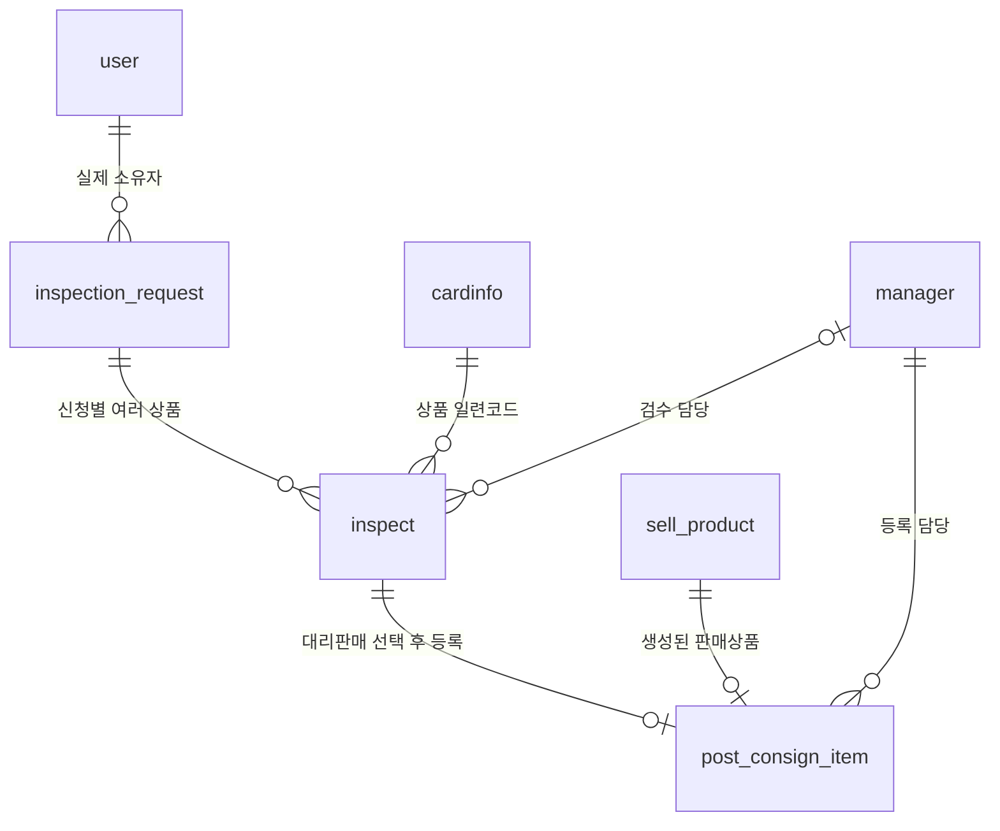

# 검수와 대리판매 DB 설계

`sql/inspection_catalog_workflow.sql`을 현재 DB에 적용하고 검증했습니다.
이미 적용한 DB에는 반복 실행하지 않습니다. 적용 전후 DDL은 같은 폴더의 inspection_schema_before/after.json에 저장했습니다.
기존 검수신청 2건·카탈로그 10건과 판매상품 순번은 보존했으며 검수·대리판매 테스트 데이터를 만들지 않았습니다.

## inspect

테이블 이름은 기존 `inspect`를 유지합니다.

| 컬럼 | 타입 / 용도 |
| --- | --- |
| inspect_code | VARCHAR(80), 기본키. INS_일련코드-seq 규칙 |
| inspect_serial_code | VARCHAR(50), cardinfo.cardinfo_serial_code 외래 키 |
| seq | BIGINT UNSIGNED, 일련코드별 검수 순번. 1 이상 |
| inspect_requested_no | VARCHAR(14), inspection_request.inspection_request_no 외래 키 |
| inspect_status | 검수대기 / 검수중 / 검수완료. 기본 검수대기 |
| inspect_date | 기존 VARCHAR(45), 검수 완료일. 미완료 시 NULL |
| inspect_grade_reason | 기존 VARCHAR(200), 판정 사유 |
| inspect_grade | 기존 VARCHAR(45), 검수 등급 |
| inspect_user_choice | 기존 inspect_intention을 변경. NULL / 의사확인대기 / 반환 / 대리판매 |
| inspect_user_choice_at | VARCHAR(45), 사용자가 반환/대리판매를 선택한 시각 |
| manager_manager_id | 검수 담당 관리자 외래 키. 배정 전 NULL 가능 |

inspect의 sell_product 참조와 컬럼은 제거했습니다.
중복되던 inspect.user_user_id도 제거하고 신청자는 검수신청에서 확인합니다.
검수신청 FK 컬럼은 inspection_request_inspection_request_no에서 inspect_requested_no로 변경했습니다.
신청 번호에는 UNIQUE를 두지 않으므로 한 신청에 여러 검수 상품이 연결됩니다.
(inspect_serial_code, seq)는 UNIQUE입니다.

검수 코드 예: INS_J_m6a_125_103_SAR-1.
코드 문자열은 API에서 생성할 규칙이며 이번 작업은 이를 저장할 DB 구조까지입니다.
검수 API와 독립 순번 발급을 구현했습니다. 사용법은 docs/inspection_api.md에 있습니다.

## 독립 순번

cardinfo.cardinfo_last_inspect_seq BIGINT UNSIGNED DEFAULT 0을 추가했습니다.
cardinfo_last_sell_seq와 독립적으로 사용합니다.
검수 API에서는 카탈로그 행을 FOR UPDATE로 잠근 뒤 검수 순번 증가와 inspect 저장을 같은 트랜잭션으로 처리해야 합니다.

## post_consign_item

inspect_inspect_code VARCHAR(80) NOT NULL 외래 키를 추가했습니다.
검수 코드에 UNIQUE를 두어 하나의 검수 상품은 한 번만 대리판매 등록합니다.
판매상품 코드에도 UNIQUE를 두어 한 상품이 여러 대리판매 등록에 연결되지 않게 했습니다.
기존 관리자·판매상품 관계 및 다른 컬럼과 기본키는 유지합니다.

실제 판매자 조회 경로:
post_consign_item → inspect → inspection_request → user.
등록 관리자는 실제 소유자나 판매대금 지급 대상이 아닙니다.

## 이후 API에서 처리할 규칙

검수 완료 전 선택은 NULL, 완료하면 의사확인대기, 신청자가 반환 또는 대리판매를 선택하는 흐름입니다.
상태/선택 값의 범위는 DB CHECK로 제한했지만 단계별 전이와 완료 정보 검증은 API에서 구현해야 합니다.
대리판매 등록 시 검수 완료·대리판매 선택·기존 등록 여부를 확인한 뒤 판매상품 생성과 등록 기록 저장을 묶어야 합니다.
사용자 선택의 기준은 inspect_user_choice이며 기존 대리판매 테이블의 다른 속성은 이번 작업에서 변경하지 않았습니다.

일반/대리판매 판매자 조회를 sale_registration_service로 통합했습니다. 구매·확정·취소·리뷰·채팅에서 위 경로를 사용하며 대금은 실제 소유자에게 지급합니다.
