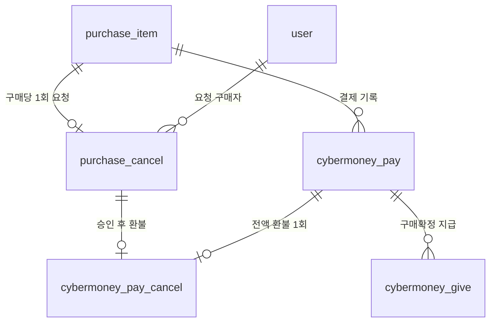

# 구매취소 요청과 판매자 승인

현재 연결된 DB에는 `sql/purchase_cancel_workflow.sql`을 적용했습니다.
관리자 참조는 환불 테이블에서 제거했습니다. 취소와 환불의 처리자는 거래 당사자이며 관리자 계정을 요구하지 않습니다.
기존 지급완료 구매 1건의 상태와 확정일을 지급 기록으로 이관했습니다. 잔액과 기존 금융 기록은 변경하지 않았습니다.
마이그레이션 SQL은 이미 적용한 DB에서 반복 실행하지 않습니다.

## 사용 순서

1. 구매자로 로그인하고 `POST /purchase_cancel`을 호출합니다.

```json
{
  "purchase_item_purchase_item_code": "구매코드",
  "purchase_cancel_reason": "판매자와 합의하여 취소 요청합니다."
}
```

구매 상태만 `취소요청`이 됩니다. 상품은 `거래중`이며 아직 돈을 반환하지 않습니다.
응답의 `purchase_cancel_code`를 사용하여 다음을 실행합니다.

| API | 호출자와 효과 |
| --- | --- |
| `GET /purchase_cancel` | 본인이 구매자 또는 판매자인 요청 목록. 관리자는 전체 조회 |
| `GET /purchase_cancel/{cancel_code}` | 당사자 또는 관리자의 상세 조회 |
| `POST /purchase_cancel/{cancel_code}/approve` | 판매자 승인 및 실제 환불 |
| `POST /purchase_cancel/{cancel_code}/reject` | 판매자 거절, 구매를 거래중으로 복원 |
| `POST /purchase_cancel/{cancel_code}/withdraw` | 구매자 철회, 구매를 거래중으로 복원 |
| `POST /sell_product/{sell_product_code}/relist` | 과거 거래취소 상태로 남은 상품의 복구용 (신규 승인 시 자동 복구) |

승인·거절은 본문 없이 호출하거나 `{"response_reason": "합의 완료"}`를 전송합니다.
철회·재판매는 본문이 없습니다.
구매 건당 취소 요청은 한 번만 가능합니다. 거절/철회 이후 재요청은 지원하지 않습니다.
취소 요청 중에는 구매확정이 차단됩니다. 거절·철회 이후에는 구매확정할 수 있습니다.
관리자 토큰은 요청·승인·거절·철회·재판매를 대신 실행할 수 없습니다.

## 승인 트랜잭션

거래 당사자 계정(정렬 순서) → 상품 → 구매 → 판매등록 → 결제 → 취소 요청을 잠급니다.
이미 지급·환불되었는지 확인하고 실제 결제 금액을 기준으로 다음을 함께 처리합니다.

- 구매자의 보유머니 증가
- `cybermoney_pay_cancel`에 금액·취소 요청·결제 연결 기록 저장
- 결제 상태를 `결제취소`로 변경
- 구매 건은 `거래취소`로 변경하고 상품은 `판매중`으로 복구
- 요청 상태를 `승인`으로 변경하고 응답자·응답일·사유 기록

하나라도 실패하면 모두 rollback합니다. 완료일은 NULL로 유지하며 `cybermoney_give`는 생성하지 않습니다.
중복 승인·미결제·구매확정·기존 지급·기존 환불·잔액 상한 초과는 409입니다.
환불 금액은 상품의 현재 가격이 아닌 `cybermoney_pay_price`입니다.

승인 시 상품이 자동으로 판매중으로 돌아갑니다. 요청 중에는 상품의 거래중 상태를 유지하고, 거절·철회 시 진행 중인 거래를 유지합니다.
별도 재판매 버튼은 사용하지 않습니다. 기존 relist API는 과거 거래취소 상태로 남은 상품의 복구용으로 유지합니다.
이 변경은 이후 승인부터 적용되며 기존 상품 상태를 일괄 변경하지 않습니다.
재구매 시에는 새 구매·결제 기록을 만들고 이전 취소 이력은 보존합니다.
리뷰는 구매 건의 `구매확정` 상태와 `purchase_item_confirmed_at`을 기준으로 작성 자격을 확인합니다.
이전 취소 구매자는 상품이 나중에 다른 거래에서 확정되더라도 리뷰를 쓸 수 없습니다.

## DB 관계



- `purchase_item_status`: 거래중 / 취소요청 / 거래취소 / 구매확정
- `purchase_item_confirmed_at`: 구매확정 시각. 거래취소 시 NULL
- `purchase_cancel_status`: 요청중 / 승인 / 거절 / 철회
- `responded_by_user_id`: 승인·거절 판매자 또는 철회 구매자
- 구매 코드 UNIQUE: 구매당 취소 요청 1개
- 환불의 결제 코드와 취소 요청 코드 각각 UNIQUE: 중복 환불 방지
- 취소 요청 코드: 구매코드_요청일시, 최대 66자
- 환불 코드: 결제코드_환불일시, 최대 87자(VARCHAR 90)

기존 취소 테이블은 비어 있어 중복 상품 컬럼과 관리자 컬럼을 제거했습니다.
새 DB에 적용할 때 기존 취소 데이터가 있으면 먼저 구매 코드/요청 코드로 매핑해야 합니다.

## 검증 범위

전체 자동 테스트 91개가 통과했습니다.
취소→승인→환불→재판매→재구매→확정→리뷰와 단계별 오류 시 실제 데이터 원복을 SQLite 테스트 DB에서 확인했습니다.
SQLite 테스트는 MySQL의 동시 행 잠금 동작을 검증하는 테스트는 아닙니다.
실제 연결된 DB에서는 스키마와 이관 결과만 검증했고 실제 취소·환불은 실행하지 않았습니다.
